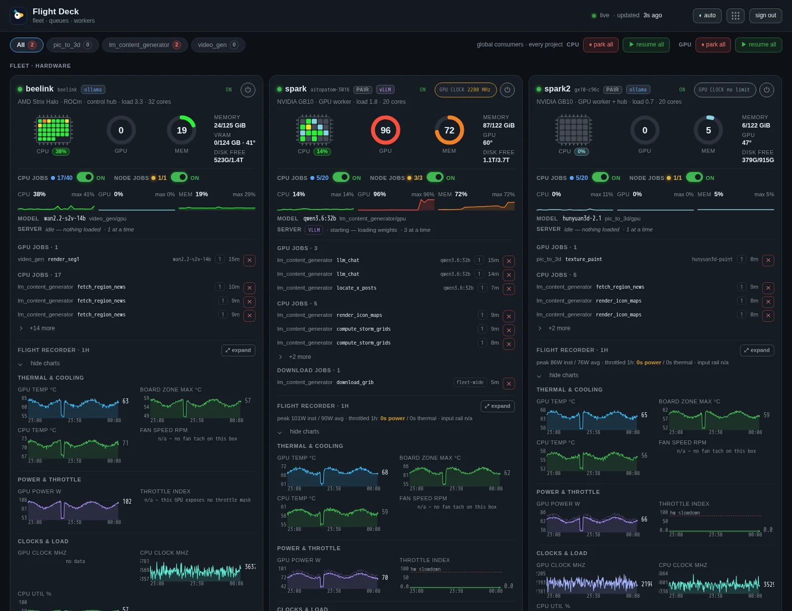

<div align="center">


# broker_parrot

**A self-hosted job fleet on the database you already run: Postgres or SQLite.**

[](LICENSE)
[](#installation)
[](#installation)
[](#installation)
[](#hand-it-to-a-coding-agent)

[Quickstart](#quickstart) · [How it works](#how-it-works) · [Docs](#documentation) · [License](#license)

</div>

broker_parrot is a workflow engine that uses your database as the message bus. There is no Redis, no RabbitMQ and no Celery to set up, monitor and back up.

- **Enqueue** by inserting a row.
- **Claim** with `SELECT … FOR UPDATE SKIP LOCKED`.
- **Recover** from crashes automatically: a dead worker's lease lapses and a sweep puts its job back in the queue.

It is built for a handful of mixed CPU/GPU machines you already own. You can turn any machine's worker on or off, keep GPU models loaded between jobs, and let each job run on whichever box has room, all without a cluster scheduler.

<p align="center">
  
</p>

<p align="center"><sub><b>Flight Deck</b>, a custom front-end built on the engine's telemetry: per box, an hour of thermal, power and clock history, the jobs running on it, and an on/off toggle per queue. The telemetry is ordinary rows and notifications, so a view like this is easy to build.</sub></p>

---

## Contents

- [Quickstart](#quickstart)
- [Why use the database as the queue?](#why-use-the-database-as-the-queue)
- [How it works](#how-it-works)
- [Two job families](#two-job-families)
- [GPU fleets](#gpu-fleets)
- [Turning workers on and off](#turning-workers-on-and-off)
- [One broker for many projects](#one-broker-for-many-projects)
- [Hand it to a coding agent](#hand-it-to-a-coding-agent)
- [Installation](#installation) · [Running in production](#running-in-production) · [Migrations](#migrations) · [Tests](#tests)
- [When not to use it](#when-not-to-use-it) · [How it compares](#how-it-compares)
- [Documentation](#documentation) · [Contributing](#contributing) · [License](#license)

---

## Quickstart

No database server needed: SQLite is the default backend, and every line below is public API.

```bash
pip install "queue_workflows @ git+https://github.com/robertziel/broker_parrot"
```

```python
# quickstart.py: run it with `python quickstart.py`
import os, types, uuid

import queue_workflows
from queue_workflows import db, dispatcher, node_queue, run_store
from queue_workflows.claim_worker import ClaimWorker

os.environ.setdefault("QUEUE_WORKFLOWS_DB_URL", "quickstart.db")   # the queue is this file
queue_workflows.configure()                     # SQLite is the default backend

# A "node" is any module with a run() function. Register one inline:
hello = types.ModuleType("hello")
hello.run = lambda **_: {"greeting": "hello, world"}
queue_workflows.set_node_resolver(lambda name: hello)

# One workflow -> one pipeline -> one node.
queue_workflows.set_workflow_provider(
    lambda n: {"name": "hi", "mode": "node",
               "steps": [{"id": "s", "kind": "pipeline", "pipeline": "hi"}]},
    lambda n: {"name": "hi", "nodes": [{"id": "hello", "node": "hello"}]},
)

db.bootstrap()                                  # applies the migration chain (idempotent)

run_id = str(uuid.uuid4())
run_store.insert_run(run_id=run_id, workflow_name="hi")   # inserting a row IS enqueuing
dispatcher.start_run(run_id)                              # fan out the ready nodes

ClaimWorker(queue="cpu", host="laptop").run_once()        # claim + execute the node
print(node_queue.list_jobs_for_run(run_id)[0]["status"])  # -> completed
```

A row went in, a worker claimed it, the node ran, and its final status and dispatch event were saved in one transaction. Scaling up from here is configuration, not new code:

1. **A real project layout**: nodes as modules, pipelines and workflows as JSON. See [`docs/setup.md`](docs/setup.md).
2. **A real fleet**: `configure(db_backend="pg")` with a Postgres DSN in `QUEUE_WORKFLOWS_DB_URL`, one process per role. See [`docs/deployment.md`](docs/deployment.md).
3. **GPU boxes**: warm-model cache, affinity routing, watchdogs. See [`docs/gpu_and_llm.md`](docs/gpu_and_llm.md).

---

## Why use the database as the queue?

The usual answer to "I need a job queue" is Redis plus a worker framework, and at a certain scale that is the right choice. But it is a second stateful system next to your database: one more thing to set up, secure, make highly available and keep consistent with your data.

A classic bug hides between the two: you commit a row, then enqueue a job, and the process dies in between. Now you have a row with no job, or a job with no row.

If the work already lives next to your data, the database can be the queue. The enqueue and your own write happen **in one transaction**, and that gap disappears. The cost is that the queue mechanics have to be done carefully, which is what this engine provides.

SQLite is the default because a single box then needs no server process at all: the queue is a file. Move to Postgres when you add a second machine.

| Backend | Full DAG | Warm-model affinity | Multi-tenant | Where it fits |
|---|---|---|---|---|
| **SQLite** (default) | yes | yes | no, single tenant | Local dev, single-box fleet, zero servers |
| **Postgres 14+** | yes | yes | yes, via `project` | Multi-box fleet, shared broker |

See [`docs/storage_backends.md`](docs/storage_backends.md).

---

## How it works

Three plain processes point at one database and never talk to each other directly: every interaction is a row written to, or read from, that database.

<p align="center"></p>

| Process | What it does |
|---|---|
| **Orchestrator** | Runs migrations, expands runs into node-jobs, drains the outbox, reclaims lapsed leases, flags dead workers. It never runs node code itself. |
| **Claim worker** | One process is one worker, running one job at a time by default. It `LISTEN`s, claims, runs the job, renews its lease, and writes the result. |
| **Scheduler** | A ticker that enqueues periodic ingest jobs at scheduled minutes. You don't need cron. |

### The claim: `SKIP LOCKED`, with a wake-up that can't be lost

Claiming the next job is one atomic statement (`node_queue._CLAIM_SQL`, trimmed to its core):

```sql
UPDATE workflow_node_jobs AS j
   SET status = 'running', started_at = now(),
       claimed_by = %(host)s, lease_expires_at = {lease_expr}
 WHERE j.id = (
   SELECT c.id FROM workflow_node_jobs c
    WHERE c.queue = %(queue)s AND c.status = 'queued' AND c.project = %(project)s
      AND EXISTS (SELECT 1 FROM workflow_runs r
                   WHERE r.id = c.run_id AND r.status NOT IN ('cancelled', 'failed'))
    ORDER BY {order}
    FOR UPDATE SKIP LOCKED          -- N workers claim N distinct jobs, no coordination
    LIMIT 1
 )
RETURNING *;
```

`{order}` is built only from validated integers and fixed SQL fragments, never from strings a caller passes in. The scheduling policy lives in that ordering. On GPU queues, one extra term sends work to the box that already has the model loaded:

```sql
is_priority DESC,
(required_model IS NOT DISTINCT FROM current_model) DESC,   -- warm-model affinity
priority ASC,
created_at
```

On Postgres, a row trigger fires `pg_notify('node_job_ready', <queue>)` **inside the writer's transaction**, so there is never a moment when a row is queued but no worker has been woken. A 1-second safety poll covers a dropped notification: the worst case is one second of delay, never a stuck job. SQLite has no `NOTIFY`, so there the worker runs on that 1-second poll alone.

### Liveness: one lease, five ways to die

<p align="center"></p>

While a job runs, the worker renews its lease every **10 s**; each lease lasts **600 s**. Lease length is therefore independent of job length: a 40-minute render and a 40 ms task use the same lease. If a worker dies, it stops renewing, the lease lapses, and the orchestrator's reclaim sweep (every 5 s) puts the row back in the queue. That sweep is the only recovery path for an orphaned job.

A worker can also be alive but stuck, for example on a wedged CUDA kernel or a hung driver call. Five guard threads cover those cases. Each exits with its own code, so the cause is readable from the exit status alone:

| Exit | Guard | Trips when | Outcome |
|---|---|---|---|
| `75` | wall-clock | the job runs past its time budget (CPU, download and ingest jobs) | re-queue and retry up to the limit, then fail |
| `76` | stall | no progress beat for 120 s, confirmed by 3 samples of idle GPU **and** static RAM | re-queue and retry |
| `77` | job-status | the row was cancelled or handed to another worker | self-kill only |
| `78` | GPU health | the GPU sat idle **and** RAM did not change across a 300 s window | re-queue and retry |
| `79` | worker control | an operator set `desired_state = 'off'` | re-queue, with no retry counted |

Every guard exits with `os._exit()`, which kills the process outright: a wedged CUDA kernel ignores a polite cancel flag, and killing the process is the only reliable way to free the VRAM. Retries are capped by `QUEUE_WORKFLOWS_WATCHDOG_MAX_RETRIES` (default 3). Every attempt is also written to the append-only `workflow_node_events` log for later debugging.

A hang that holds Python's GIL stops those threads from running at all. To catch it, the orchestrator, a separate process, flags any worker whose heartbeat is more than 30 s old while it still owns a running job. Details: [`docs/watchdogs.md`](docs/watchdogs.md).

### DAG dispatch and the durable outbox

<p align="center"></p>

A worker never calls the dispatcher directly. When a node finishes, the worker writes the node's final status **and** a `workflow_dispatch_events` row in one transaction:

```python
with _db_connection() as conn, conn.cursor() as cur:
    row = node_queue.mark_completed_in_txn(cur, job_id, ...)
    if row is None:
        return "skipped"                     # already terminal: idempotent
    node_queue.enqueue_dispatch_event_in_txn(cur, job["run_id"], job["node_id"], "completed")
```

The orchestrator reads that outbox and queues the downstream nodes. A failed hand-off is retried on the next tick; after 10 failed attempts the event is flagged as poison and the run is failed, so an operator sees a clear error instead of a run that silently stops. No event is ever lost, because it is saved together with the status change.

---

## Two job families

| | DAG node-jobs | Ingest jobs |
|---|---|---|
| Table | `workflow_node_jobs` | `ingest_jobs` |
| Queues | `cpu`, `gpu`, `download` (reserved) | your own names (`fetch`, `load`, …) |
| Shape | one node in a DAG | standalone, periodic or with arguments |
| Enqueued by | the dispatcher | the scheduler, or your app directly |
| Payload | `$from` inputs resolved upstream | per-job `args` JSON |
| On watchdog trip | re-queue and retry, up to 3 times | fail immediately |

The ingest path accepts your own database connection, so the enqueue is part of **your** transaction:

```python
queue_workflows.configure(db_backend="pg", db_url_env="MY_DB_URL",
                          ingest_queues=frozenset({"etl", "reports"}))
queue_workflows.register_ingest_task("build_report", build_report)   # fn(reason) or fn(reason, args)

with my_pool.connection() as conn:
    my_create_report(conn, report_id)            # your own write
    node_queue.enqueue_ingest_job(               # and the job
        task_name="build_report", queue="reports",
        args={"report_id": report_id}, conn=conn,
    )                                            # both commit, or neither does
```

---

## GPU fleets

GPU inference shaped the parts you won't usually find in a job queue:

- **Warm-model cache.** A model stays loaded across the jobs that use it; reloading a multi-gigabyte model per job is the biggest cost.
- **Affinity routing.** Each worker reports `current_model`, and the claim `ORDER BY` prefers jobs for that model, so work goes to the box that already has it loaded.
- **Capacity-aware assignment.** Models are matched to available VRAM, and a job that fits nowhere is flagged up front rather than running out of memory halfway through.
- **LLM servers.** Each box runs one ollama or vLLM server at a time. The engine starts and stops it on demand, sizes vLLM from its own startup numbers, and sheds models when RAM runs low.
- **Download lane.** A node marked `download: true` runs on its own queue with a fleet-wide limit (default 1), so network waits never take up a GPU slot. An optional `dedup_key` means the same file is never downloaded twice.
- **Hardware flight recorder.** An opt-in table records GPU temperature, power, clocks and throttle reasons per host, so you can see that a job is slow because the hardware is throttling, not because the model is big. See [`docs/hw_watch.md`](docs/hw_watch.md).

Full design: [`docs/gpu_and_llm.md`](docs/gpu_and_llm.md).

---

## Turning workers on and off

Each `(host, queue)` worker is switched on or off by writing one row to `worker_controls`, from the CLI or with plain SQL from any app that shares the database. A trigger wakes the worker immediately.

```bash
queue-worker-control --queue gpu --off                # hard stop: re-queue the in-flight job, free VRAM
queue-worker-control --queue gpu --on --host host-a   # resume, no restart needed
```

```sql
INSERT INTO worker_controls (host_label, queue, project, desired_state, stop_policy, requested_by)
VALUES ('host-a', 'gpu', '', 'off', 'hard', 'ops')            -- project '' = single tenant
ON CONFLICT (host_label, queue, project) DO UPDATE
  SET desired_state = EXCLUDED.desired_state, updated_at = now();
```

Turning a worker off sends its in-flight job back to the queue, where a healthy worker picks it up: the job is not failed and no retry is counted. The stopped worker stays idle until it is turned back on. A worker with no row in the table counts as **on**. See [`docs/worker_control.md`](docs/worker_control.md).

---

## One broker for many projects

Several apps can share one broker database. Each app tags its rows with a `project` and claims only its own rows, matched exactly inside the same `SKIP LOCKED` statement:

```python
queue_workflows.configure(project="app-a", db_backend="pg", db_url_env="BROKER_DSN")
queue_workflows.configure(project="app-b", db_backend="pg", db_url_env="BROKER_DSN")
```

See [`docs/broker.md`](docs/broker.md).

---

## Hand it to a coding agent

The repo is set up for a coding agent such as Claude Code, Cursor or Codex. All host wiring goes through one `configure()` call, the SQLite default lets the agent test a change end to end without touching your infrastructure, and the test suite doubles as the behavioural contract (it only ever runs against a database named `*_test`).

Paste this prompt, filling in the two bracketed lines:

```text
Set up broker_parrot (python package queue_workflows,
https://github.com/robertziel/broker_parrot) as the job queue for this project.

My jobs: [e.g. "fetch RSS feeds every 15 min, then summarize each new article
with an LLM on my GPU box, then publish the summary — fetch/publish are CPU,
summarize is GPU"].
My database: [e.g. "the Postgres this app already uses, DSN in env MYAPP_DB_URL"
— or "just SQLite for now"].

Steps:
1. pip install "queue_workflows @ git+https://github.com/robertziel/broker_parrot"
2. Read docs/setup.md and docs/configuration.md for the wiring pattern.
3. Create a nodes/ package (one run() module per job), pipelines/*.schema.json
   (the DAG: ids, depends_on, gpu flags), definitions/*.json (the workflow),
   and an engine.py that calls queue_workflows.configure(...),
   set_workflow_provider(...), and db.bootstrap().
4. For periodic work use register_ingest_task + set_ingest_schedule
   (docs/configuration.md) instead of cron.
5. Prove it: enqueue one run with run_store.insert_run + dispatcher.start_run,
   execute it with ClaimWorker(queue="cpu").run_once(), and show me the
   completed status. Use the SQLite default for this proof even if production
   is Postgres.
6. Give me the production launch commands (queue-orchestrator,
   queue-claim-worker per queue, queue-scheduler) from docs/deployment.md.
```

---

## Installation

**Python 3.10+**; the only required runtime dependency is `psycopg`. SQLite is the default backend. For Postgres **14+**, use `configure(db_backend="pg")` or `export QUEUE_WORKFLOWS_DB_BACKEND=pg`, and put the DSN in `QUEUE_WORKFLOWS_DB_URL`.

broker_parrot isn't on PyPI yet, so install it from GitHub. The import name is `queue_workflows`.

```bash
pip install "queue_workflows @ git+https://github.com/robertziel/broker_parrot"

# optional extras
pip install "queue_workflows[metrics] @ git+https://github.com/robertziel/broker_parrot"   # psutil CPU/RAM probe
```

## Running in production

Run one process per role, all pointed at the same database:

```bash
queue-orchestrator                 # dispatch + outbox drain + reclaim
queue-claim-worker --queue gpu     # claim and execute (cpu | gpu | download | your ingest queues)
queue-scheduler                    # periodic ingest ticker
```

All app-specific wiring is passed to the engine as hooks, and every hook has a safe default. The engine never imports anything from your app (a test enforces it). Containers, lanes and the cutover runbook: [`docs/deployment.md`](docs/deployment.md).

## Migrations

The engine owns its schema. Migrations ship with the package in `queue_workflows/migrations/` (Postgres) and `migrations_sqlite/`. `db.bootstrap()` applies them idempotently; only the orchestrator runs it, and claim workers wait until the schema is ready. An app with its own tables runs a second chain against its own version table:

```python
queue_workflows.db.bootstrap()                                   # engine chain
queue_workflows.db.bootstrap(migrations_dir="myapp/migrations",  # your chain, own ledger
                             version_table="myapp_schema_version")
```

Every table is documented in [`docs/schema.md`](docs/schema.md).

## Tests

```bash
pip install -e '.[test]'
QUEUE_WORKFLOWS_TEST_SQLITE=1 python -m pytest                    # no servers needed
QUEUE_WORKFLOWS_TEST_DB_URL=postgresql://user:pw@host:port/queue_workflows_test python -m pytest
```

The Postgres suite forces a `*_test` database name (suffixing `_test` if the DSN lacks it) and creates it if missing.

---

## When not to use it

A database-backed queue works well up to a healthy throughput ceiling, as long as your jobs already live next to your data. Choose a purpose-built broker if you need any of these:

- millions of tiny messages per second
- fan-out to many independent consumers
- jobs that have nothing to do with your relational data
- a hosted UI, multi-region durability, or replay of versioned workflows

What you get here instead is one system, one backup, one set of credentials and one transaction boundary.

## How it compares

These tools mostly sit at different layers. Triton is a model server; SkyPilot and dstack provision and run GPU jobs across clouds, Kubernetes and SSH machines; Volcano and Kueue are batch schedulers inside Kubernetes. broker_parrot is a durable job queue in the database you already run, for a handful of boxes you own.

| | broker_parrot | Triton Inference Server | SkyPilot | Volcano | Kueue | dstack |
|---|---|---|---|---|---|---|
| What it is | Job queue + DAG engine in your DB | Model server | AI workload launcher and control plane | Kubernetes batch scheduler (CNCF) | Kubernetes job queueing and quotas | GPU provisioning and orchestration |
| Runs on / needs | SQLite or Postgres; no Kubernetes | Docker, NVIDIA GPU or CPU; often Kubernetes | Clouds, Kubernetes, Slurm, SSH node pools | Kubernetes | Kubernetes | Clouds, Kubernetes, SSH fleets (Docker hosts) |
| Unit of work | A row: node-job or ingest job | Inference request (HTTP/gRPC) | Cluster, job, managed job | VolcanoJob / PodGroup | Workload (Job, JobSet, RayJob, Pods …) | Dev environment, task, service |
| Scheduling model | Workers claim with `SKIP LOCKED`, woken by NOTIFY | Per-model scheduler, dynamic batching | Finds capacity across infra, failover | Queues with weights and caps, fair-share, binpack | Admits on quota: cohorts, borrowing, preemption | Matches runs to fleet capacity |
| Multi-step DAGs | Yes, with a durable outbox | Ensembles / BLS inside one request | Sequential pipelines | JobFlow (alpha) | No; pair with Argo or Tekton | No |
| Crash/preemption recovery | Lease lapse → re-queue; watchdogs re-run a node | Out of scope (pod restart) | Managed jobs re-provision and restart | `maxRetry` + lifecycle policies | Re-queues evicted workloads | `retry` on interruption, error, no capacity |
| GPU awareness | Warm-model affinity, VRAM fit, LLM server switching | Loads models, batches requests | Picks GPU type and cloud | Gang, GPU sharing (MIG, vCUDA) | GPU quotas, all-or-nothing, topology-aware | Picks GPUs, splits hosts into blocks |
| Fleet on/off / queues | On/off per `(host, queue)`; cpu/gpu/download + ingest queues | Load/unload models | Start/stop/autostop clusters | Queue open/closed | ClusterQueue `Hold` / `HoldAndDrain` | Create/delete fleets |
| Best for | Async GPU and data jobs on a few owned boxes | Low-latency online inference | Training and batch jobs on rented GPUs | Big MPI/Spark/AI batch on Kubernetes | Shared Kubernetes clusters with team quotas | ML teams wanting dev envs, tasks, endpoints |
| License | Apache-2.0 | BSD-3-Clause | Apache-2.0 | Apache-2.0 | Apache-2.0 | MPL-2.0 |

They compose: a broker_parrot job can call Triton, vLLM or ollama, and a broker_parrot fleet can run on machines SkyPilot or dstack provisioned.

---

## Documentation

| Doc | Covers |
|---|---|
| [`setup.md`](docs/setup.md) | a full project walkthrough: node, pipeline + workflow JSON, `configure()`, the three processes |
| [`architecture.md`](docs/architecture.md) | the database as the bus, process roles, the claim, the outbox, app hooks |
| [`configuration.md`](docs/configuration.md) | `configure()`, every `set_*` / `register_*` hook, env settings |
| [`schema.md`](docs/schema.md) | every table and the full migration chain (Postgres + SQLite) |
| [`watchdogs.md`](docs/watchdogs.md) | leases, reclaim, the watchdogs, the dead-worker detector |
| [`worker_control.md`](docs/worker_control.md) | the operator on/off control plane |
| [`broker.md`](docs/broker.md) | the shared multi-project broker |
| [`gpu_and_llm.md`](docs/gpu_and_llm.md) | warm-model cache, capacity assignment, ollama / vLLM |
| [`box_placement.md`](docs/box_placement.md) | pinning a job to, or keeping it off, specific boxes |
| [`hw_watch.md`](docs/hw_watch.md) · [`hw_lan_broadcast.md`](docs/hw_lan_broadcast.md) | the hardware flight recorder and LAN telemetry broadcast |
| [`storage_backends.md`](docs/storage_backends.md) | the `sqlite` / `pg` backends |
| [`deployment.md`](docs/deployment.md) | console scripts, container lanes, migrations at deploy time |
| [`use_cases/`](docs/use_cases/README.md) | ten worked scenarios: power loss mid-job, boot and rejoin, a wedged GPU, and more |

## Contributing

Bug reports, new storage backends and doc fixes are all welcome.

- **Tests come first.** A change in behaviour comes with the test that pins it down (`tests/test_invariant_*.py` for engine guarantees).
- **Stay app-agnostic.** The engine imports nothing from any app. New settings go through `configure()` / `envcompat` with a safe default.
- **Keep SQLite and Postgres both green.**

If broker_parrot saved you from running a separate broker, a ⭐ helps others find it.

## License

**Apache-2.0** ([`LICENSE`](LICENSE)) © Robert Zieliński. Use it, modify it and ship it, commercially or not; keep the license and copyright notice.

Earlier releases keep the terms they shipped with: versions ≤ 1.0.1 are MIT, 1.0.2 is PolyForm Noncommercial 1.0.0, and 1.0.3–1.4.0 are AGPL-3.0-or-later.
